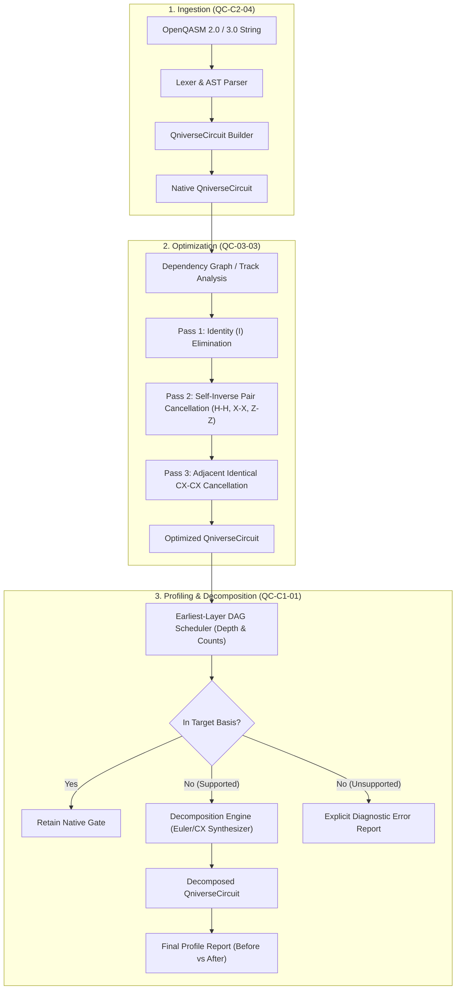

# Technical Approach - Team Eigen

## Problem Overview

In modern quantum software architectures, transpilation and optimization pipelines are vital to bridge hardware-agnostic quantum algorithms with physical quantum processors (QPUs). Quantum circuits written in standard description languages like **OpenQASM 2.0 and 3.0** must be ingested, cleaned of redundant gates, mapped to restricted native hardware basis sets, and accurately profiled for resource consumption.

Team Eigen tackles this challenge by constructing an integrated, modular quantum compilation pipeline tailored for C-DAC's **Qniverse / QSDK** platform, addressing three synergistic hackathon problem statements:
1. **QC-C2-04**: *OpenQASM 2.0/3.0 to QniverseCircuit Converter*
2. **QC-03-03**: *Quantum Circuit Optimization Using QSDK*
3. **QC-C1-01**: *Circuit Profiling and Limited Basis-Gate Decomposition*

---

## Proposed Methodology

### Module 1: OpenQASM 2.0/3.0 Converter (`QC-C2-04`)
- **Version Detection**: Inspects header pragmas (`OPENQASM 2.0;` vs `OPENQASM 3.0;`).
- **Lexical & Syntactic Analysis**: Parses registers (`qreg`, `creg`, `qubit[n]`, `bit[n]`), single-qubit gates (`h`, `x`, `y`, `z`, `s`, `sdg`, `t`, `tdg`), parameterized rotation gates (`rx(θ)`, `ry(θ)`, `rz(θ)`, `p(λ)`, `u(θ,ϕ,λ)`), entangling gates (`cx`, `cz`, `swap`), barriers, and measurements (`measure q -> c;`).
- **Semantic Mapping**: Constructs a native `QniverseCircuit` without assuming undocumented constructors or internal APIs.
- **Diagnostics**: Non-fatal warnings for unrecognized comments or supported pragmas; structured error reports for malformed syntax or unsupported higher-order language constructs.

---

### Module 2: Rule-Based Circuit Optimizer (`QC-03-03`)
The optimizer operates as a non-mutating transformation pipeline that accepts an input `QniverseCircuit` and returns an independent optimized circuit copy.

#### 1. Optimization Rules
- **Identity Elimination**:
  $$I \cdot |\psi\rangle = |\psi\rangle \implies \text{Drop } I \text{ gates}$$
- **Self-Inverse Pair Cancellation**:
  Any unitary satisfying $U^2 = I$ cancels to identity when two instances act sequentially on the same qubit wire with no intervening gates:
  $$H \cdot H = I, \quad X \cdot X = I, \quad Y \cdot Y = I, \quad Z \cdot Z = I$$
- **Adjacent Two-Qubit CX Cancellation**:
  Two consecutive CNOT ($CX$) gates acting on the identical control-target qubit pair $(c, t)$ cancel:
  $$CX(c, t) \cdot CX(c, t) = I$$

#### 2. Preservation Guarantees
- **Barriers**: Barriers enforce explicit optimization firewalls. Rewrite rules are strictly prevented from canceling gates across a barrier.
- **Measurement and Classical Dependencies**: Mid-circuit measurements, resets, and conditioning are preserved in their exact topological order.
- **Wire Dependency Tracking**: Rewrite opportunities are detected by traversing wire-level operation tracks rather than naive list adjacency, allowing independent gates on other wires to be bypassed without blocking cancellations.

---

### Module 3: Circuit Profiler & Limited Basis-Gate Decomposition (`QC-C1-01`)

#### 1. Circuit Profiling & Metrics Calculation
The profiler computes structured metrics:
- **Qubit Allocation**: Total declared qubits vs physically used qubits.
- **Gate Counts**: Total gate count, single-qubit gate count, multi-qubit gate count, two-qubit gate count ($CX$, $CZ$, $SWAP$), and a frequency dictionary broken down by gate identifier.
- **Earliest-Available-Layer Scheduled Depth**:
  Circuit depth is determined using an Earliest-Deadline-First / Earliest-Available-Layer Directed Acyclic Graph (DAG) model:
  $$\text{layer}(op) = 1 + \max_{q \in \text{qubits}(op)} \text{qubit\_layer}[q]$$
  $$\forall q \in \text{qubits}(op): \quad \text{qubit\_layer}[q] \leftarrow \text{layer}(op)$$
  $$\text{Circuit Depth} = \max_{q} \text{qubit\_layer}[q]$$
  Operations on disjoint sets of qubits execute concurrently in the same layer; operations sharing a qubit strictly respect circuit execution order.

#### 2. Limited Basis-Gate Decomposition
Given a user-selected target basis set $\mathcal{B}$ (e.g. $\mathcal{B}_1 = \{rx, ry, rz, cx\}$, $\mathcal{B}_2 = \{u, cx\}$, or $\mathcal{B}_3 = \{h, t, t^\dagger, cx\}$):
- If $op \in \mathcal{B}$: Retain gate unmodified.
- If $op \notin \mathcal{B}$: Apply deterministic algebraic decomposition:
  - Hadamard to rotation basis:
    $$H = R_z\left(\frac{\pi}{2}\right) R_x\left(\frac{\pi}{2}\right) R_z\left(\frac{\pi}{2}\right)$$
  - Pauli-$X$ to rotation basis:
    $$X = R_x(\pi)$$
  - Arbitrary single-qubit gate via $Z$-$Y$-$Z$ Euler angles:
    $$U(\theta, \phi, \lambda) = R_z(\phi) R_y(\theta) R_z(\lambda)$$
  - $SWAP$ gate into $3 \times CX$:
    $$SWAP(q_0, q_1) = CX(q_0, q_1) \cdot CX(q_1, q_0) \cdot CX(q_0, q_1)$$
- **Unsupported Operation Handling**: If a gate cannot be decomposed into the requested basis (e.g., non-unitary operations or gates without a closed-form decomposition in $\mathcal{B}$), the profiler halts decomposition and emits an explicit diagnostic report without silently emitting an invalid circuit.

---

## Non-Mutating Execution & Verification Architecture

All modules adhere strictly to functional safety:
- **Immutability**: Input circuits are deep-copied or treated as read-only streams. Output circuits are newly allocated `QniverseCircuit` instances.
- **Equivalence Verification**: Correctness is verified by comparing simulated statevectors (up to global phase) or output probability distributions between original and transformed circuits:
  $$|\langle \psi_{\text{orig}} | \psi_{\text{decomposed}} \rangle|^2 \approx 1$$
- **Reproducible Performance**: Before-and-after gate counts and scheduled circuit depth are logged directly from actual executions into `results/` and `docs/03_performance_report.md`.
